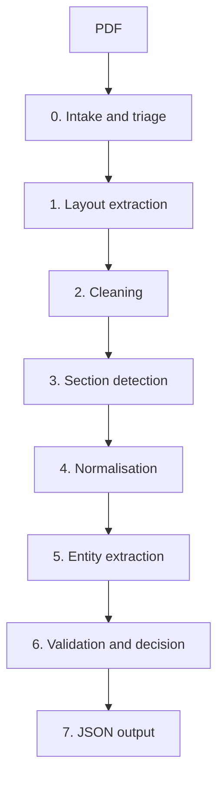

# Academic CV Parser and Shortlisting System

A rule-based, deterministic system that turns academic CVs (PDF) into structured JSON and ranks candidates against a recruiter's requirements.

- **No LLM.** Parsing and ranking are rule-based and explainable.
- **Local.** The project's code makes no network calls, and resume data stays outside the repository.
- **Reproducible.** The parser gives byte-identical output for the same input.
- **Traceable.** Extracted entries record the page and lines they came from.

> **Status:** research project. Accuracy drops noticeably on unseen CVs (see [Results](#results)), so check the output by hand before making any decision about a candidate.

## Contents

- [Overview](#overview)
- [Quick start](#quick-start)
- [Usage](#usage)
- [Output](#output)
- [How the parser works](#how-the-parser-works)
- [How ranking works](#how-ranking-works)
- [Ranking lexicons](#ranking-lexicons)
- [Testing and evaluation](#testing-and-evaluation)
- [Results](#results)
- [Known limitations](#known-limitations)
- [Project structure](#project-structure)
- [Contributing and privacy](#contributing-and-privacy)
- [License](#license)

## Overview

| Part | Location | What it does |
|------|----------|--------------|
| CV parser | `src/resume_parser/` | Extracts the candidate name, education, work experience and publications from PDF CVs |
| Shortlisting | `src/shortlisting/` | Scores and tiers parsed CVs against a requirement profile |
| Recruiter UI | `app/streamlit_app.py` | Streamlit app to upload CVs, set requirements, review and export results |

Only those four kinds of information are targeted. Everything else is best effort. The aim is to miss as little as possible: extract generously, keep the raw text, and flag CVs where the parser is unsure.

**Built with:** Python, pdfplumber, pdfminer.six, RapidFuzz, jsonschema, NumPy, SciPy, Streamlit and pytest. scikit-learn is optional.

## Quick start

**Requirements:** Git and Python 3.11 or newer.

### macOS / Linux

```bash
git clone https://github.com/shrey-sp4/Resume-parser-nlp
cd Resume-parser-nlp

python3 -m venv .venv
source .venv/bin/activate

pip install -r requirements.txt
pip install -e .

mkdir -p "$HOME/resume_data/pdfs"
export RESUME_DATA_DIR="$HOME/resume_data"
```

### Windows (PowerShell)

```powershell
git clone https://github.com/shrey-sp4/Resume-parser-nlp
cd Resume-parser-nlp

py -3 -m venv .venv
.\.venv\Scripts\Activate.ps1

pip install -r requirements.txt
pip install -e .

New-Item -ItemType Directory -Force "$env:USERPROFILE\resume_data\pdfs" | Out-Null
$env:RESUME_DATA_DIR = "$env:USERPROFILE\resume_data"
```

Notes:

- `pip install -e` is required. Without it, `python -m resume_parser.cli` cannot find the package.
- The `learn` extra is optional: `pip install -e ".[learn]"`. It adds scikit-learn for the experimental publication reader and for optional job-ad keyword extraction.
- `RESUME_DATA_DIR` set this way lasts only for the current terminal. To keep it on macOS (zsh), add the `export` line to `~/.zshrc`.

### Try it with invented CVs

No real data is needed. This creates three fake resumes and parses them (macOS / Linux; use an empty data folder):

```bash
python scripts/make_synthetic_resumes.py "$RESUME_DATA_DIR/pdfs"
python -m resume_parser.cli run
```

The results appear in `$RESUME_DATA_DIR/outputs/`.

## Usage

### Recruiter UI

```bash
streamlit run app/streamlit_app.py --browser.gatherUsageStats false
```

Open <http://localhost:8501>. The flag turns off Streamlit's own usage statistics.

1. Choose a folder of PDFs, or upload files.
2. Choose what matters most, the field, any requirements and topic keywords.
3. Click **Rank the CVs**.
4. Review the tabs and download the ranked table as CSV.

| Tab | Meaning |
|-----|---------|
| **Shortlist** | Score reaches the threshold with at least medium certainty |
| **Review** | Needs a human look, for example because certainty is low |
| **Hold** | Failed an eligibility requirement or scored below the threshold. Open the card to see why |
| **Unreadable** | The CV could not be parsed. Listed apart, not rejected |

Work files are saved in `RESUME_SHORTLIST_DIR` if set, otherwise in `RESUME_DATA_DIR/shortlist_runs`.

### Command-line parser

Put PDF files directly in `RESUME_DATA_DIR/pdfs/`.

| Command | What it does |
|---------|--------------|
| `python -m resume_parser.cli run` | Parse all PDFs in the data folder |
| `python -m resume_parser.cli run path/to/cv.pdf` | Parse one PDF |
| `python -m resume_parser.cli run --save-stages` | Also save intermediate stage output |
| `python -m resume_parser.cli check-determinism` | Run twice and compare outputs byte for byte |
| `python -m resume_parser.cli validate-gt` | Validate ground-truth JSON against the schema |
| `python -m resume_parser.cli --help` | List all commands |

The console shows hashed resume IDs, never names, emails or phone numbers.

### Command-line ranking

```bash
python -m shortlisting.cli --profile profile.json --outputs <parser-outputs> --out <ranking.csv>
```

The requirement profile fields are described in `src/shortlisting/profile.py`. The CSV must be written outside the repository.

## Output

```
RESUME_DATA_DIR/
├── outputs/
│   ├── <name>.json          Parsed CV
│   ├── <name>.meta.json     Decision, flags, scores, provenance
│   └── run_index.json       One row per CV
├── review_queue/
│   └── review_queue.json    CVs that were not accepted
└── reports/
    └── run_summary.json     Aggregate statistics
```

### Example

Parsed from the invented resume `synthetic_a_simple.pdf` (lists shortened to one entry each):

```json
{
  "resume_file": "synthetic_a_simple.pdf",
  "candidate_name": "Mira Testwood",
  "education": [
    {
      "degree": "Ph.D.",
      "degree_level": "doctorate",
      "stream": "Computational Biology",
      "institution": "Northfield Institute of Science"
    }
  ],
  "experience": [
    {
      "job_title": "Assistant Professor",
      "institution": "Department of Biology, Hillcrest University",
      "dates": "Jul 2023 - Present",
      "experience_type": "academic"
    }
  ],
  "publications": [
    {
      "title": "Modelling gene networks with sparse graphs",
      "type": "journal",
      "year": "2022",
      "venue": "Journal of Invented Biology"
    }
  ],
  "stated_totals": { "journal": null, "conference": null, "total": 2 },
  "notes": ""
}
```

Extraction rules: higher education only (bachelor's and above), jobs only under experience, dates kept as printed, and nothing guessed when the CV does not say.

Each parsed CV gets one decision:

| Decision | Meaning |
|----------|---------|
| `ACCEPT` | No review reason was raised |
| `NEEDS_REVIEW` | For example a missing section, a low section score or a name taken from the email or file name |
| `FAIL` | No usable text, or no candidate name found |

`ACCEPT` means the internal checks passed, not that the extraction is verified correct.

## How the parser works



Stages 1 to 4 absorb the differences between CVs (layout, fonts, bullets, heading wording) and produce one standard **Canonical Document**. Stage 5 reads only that document.

| Stage | Code | Summary |
|-------|------|---------|
| 0 | `intake.py` | Checks that the PDF opens and has a text layer; profiles each page |
| 1 | `extract/` | Builds positioned lines with pdfplumber and pdfminer.six, reads tables, corrects clear two-column layouts |
| 2 | `clean.py` | Removes repeated headers, footers and bullet glyphs; joins wrapped lines |
| 3 | `sections.py`, `headings.py` | Finds headings from vocabulary, appearance and content |
| 4 | `normalize.py` | Maps sections to `personal`, `education`, `experience`, `publications` or `other` |
| 5 | `entities/`, `field_norm.py` | Splits sections into entries and extracts fields |
| 6 | `validate.py`, `scoring.py` | Scores sections and decides `ACCEPT`, `NEEDS_REVIEW` or `FAIL` |
| 7 | `writer.py`, `report.py` | Validates against JSON schemas and writes output |

**Design principles**

- Never silently drop text: unmatched content is kept as `other` or `unassigned`.
- Each stage has an ordered chain of methods with fallbacks, a check and a status (`OK`, `WARN`, `FAIL`).
- Checks on new CVs need no ground truth.
- Vocabulary and thresholds live in `config/`, not in code.

A `FAIL` at stage 0 or 1 stops that CV. Later problems are flagged and the output is still written. Full rules are in [`docs/design.md`](docs/design.md).

## How ranking works

Each candidate is scored on four components. The weights depend on what the recruiter says matters most:

| Mode | Education | Experience | Publications | Topic fit |
|------|----------:|-----------:|-------------:|----------:|
| Default | 25 | 20 | 25 | 30 |
| Education-heavy | 50 | 10 | 15 | 25 |
| Experience-heavy | 15 | 40 | 15 | 30 |
| Publications-heavy | 15 | 10 | 45 | 30 |

- **Education:** degree level, institution tier and stream fit.
- **Experience:** whether the required years are met.
- **Publications:** venue tier and recency, with a cap so that raw counts matter less.
- **Topic fit:** keyword matching. It is dropped when no keywords are given.

The shortlist threshold is 0.6. Settings are in `config/shortlisting.json`.

## Ranking lexicons

Journal, conference and institution tiers need third-party ranking files. They are **not included** in this repository, so obtain them from their publishers or the maintainer.

Place them in `RESUME_LEXICON_DIR`, or by default `RESUME_DATA_DIR/Lexicons`:

```
Lexicons/
├── scimagojr 2025.csv     SCImago journal list
├── core/
│   └── ICORE2026.csv      ICORE conference list
└── nirf_2025/             Saved NIRF 2025 ranking pages (HTML)
```

File names are set in `config/tiers.json`. Institutions outside India use a seed list in `config/`. An unlisted venue or institution is not by itself a rejection.

## Testing and evaluation

```bash
pytest -q
```

Expected result: `490 passed, 1 xfailed`. Tests build invented CVs in a temporary folder.

The `eval/` folder holds offline tools that need a private ground-truth set:

| Tool | Purpose |
|------|---------|
| `evaluate.py` | Precision, recall and F1 against ground truth |
| `funnel.py` | Finds the first stage where each item is lost |
| `calibrate_thresholds.py` | Chooses the review thresholds |
| `end_to_end.py` | Combined development report |
| `fresh.py` | Guarded one-time run on a held-out set |

Entry matching is fuzzy and one-to-one. Validation, final and fresh sets are reported as aggregates only, and their runs are logged to limit tuning against them.

## Results

F1 scores (%) recorded by the maintainer. The evaluation data is private, so these cannot be reproduced from this repository.

| Field | Development (30 CVs) | Validation (10) | Final (10) | Fresh (10) |
|-------|---------------------:|----------------:|-----------:|-----------:|
| Publications | 81.4 | 74.3 | 72.4 | 58.9 |
| Education | 49.0 | 54.8 | 42.4 | 50.0 |
| Experience | 55.9 | 44.4 | 15.0 | 33.2 |

Candidate name accuracy (normalised): 83.3%, 100%, 80% and 60% on the same sets.

How to read these:

- The rules were tuned on the development set, so those scores are optimistic.
- Validation is not fully unseen, and the final set was run on earlier code.
- Held-out sets are small, so differences between them are uncertain.
- Most losses occur while building entries (stage 5). At least 99% of ground-truth text is found at stage 1.

## Known limitations

- **No OCR.** Scanned or image-only CVs cannot be read. The Tesseract method is a placeholder.
- **Weak generalisation**, especially for work experience.
- **Over-splitting**, particularly of publications (751 predicted against 523 true on the fresh set).
- **Review flags are not selective:** they fired on nearly all evaluated CVs.
- **Layout sensitivity:** complex tables, sidebars and unusual headings can break ordering or sectioning.

**Possible improvements:** add OCR, improve entry splitting, widen heading and title vocabularies, and make review flags more selective.

## Project structure

```
.
├── app/                  Streamlit recruiter UI
├── config/               Vocabularies, thresholds, ranking settings
├── docs/design.md        Detailed design (some sections are dated)
├── eval/                 Evaluation and calibration tools
├── fixtures/synthetic/   Notes on invented test data
├── schema/               JSON schemas for output files
├── scripts/              Synthetic CV generators and repository guard
├── src/
│   ├── resume_parser/    Parsing pipeline
│   └── shortlisting/     Scoring, ranking and tier lookups
├── tests/                Test suite
├── pyproject.toml        Package metadata
└── requirements.txt      Pinned dependencies
```

## Contributing and privacy

- **Never commit resumes, ground truth, parser outputs or ranking files.**
- Enable the pre-commit guard once per clone: `git config core.hooksPath .githooks`
- Run it by hand with `python scripts/check_no_data.py`. CI also runs it, along with the tests on Python 3.11 and 3.14.
- Use only invented data in tests and examples.

## License

[MIT](LICENSE). Third-party ranking data is not covered by this license.